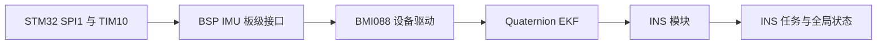
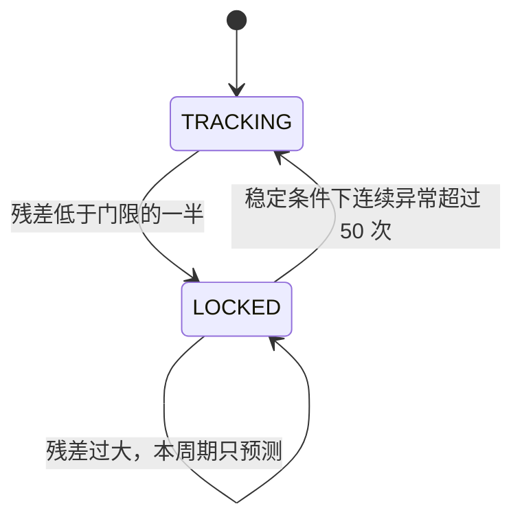

# BMI088 与 INS 姿态解算完整入门

本文面向第一次接触 IMU、SPI 和姿态解算的读者，说明当前工程如何从 BMI088 读取原始数据，如何通过
Quaternion EKF 得到姿态，以及 INS 模块最终向上层提供了什么。

本文只解释当前已经移植的实现，不改变参考工程的接口、参数或算法。当前代码链和主机回归已经完成，
真实板卡上的方向、温升、漂移和任务栈仍需上板确认。

> [!WARNING]
> 文档复核时发现当前加速度灵敏度常量与后续重力换算存在约 `9.80665` 倍的重复换算风险。它会直接影响
> 加速度、静止判据、姿态量测和运动加速度。本文在 4.5 节给出完整核算。该问题尚未修改源码，不能在修正或
> 证明当前常量单位之前把 INS 软件判定为最终可上板版本。

## 1. 先看整条数据链

当前实现可以概括为下面五层：



各层职责如下：

| 层级 | 文件 | 职责 |
|---|---|---|
| HAL/CubeMX | `Src/spi.c`、`Src/tim.c`、`Src/gpio.c` | 配置 SPI、GPIO、DMA 资源和加热 PWM |
| BSP | `User/bsp/imu.c` | 控制片选、收发 SPI 字节、提供延时、设置加热占空比 |
| Device | `User/device/bmi088.c` | 配置 BMI088 寄存器、读取原始值并换算为 SI 单位 |
| Component | `User/component/quaternion_ekf.c` | 融合角速度和重力方向，估计四元数与陀螺仪零偏 |
| Module | `User/module/ins.c` | 修正安装方向、更新姿态、分离重力、控制温度、处理故障 |
| Task | `User/task/ins_task.c` | 以 1000 Hz 调度 INS，并使用实际经过时间作为 `dt` |

一次正常更新的数据流是：

1. `INS_Task` 等待下一个 1 ms 周期
2. 任务用微秒时基计算真实 `dt`
3. `BMI088_Read()` 依次读取加速度、角速度和温度
4. 设备驱动把寄存器原始值换算成 `m/s^2`、`rad/s` 和摄氏度
5. INS 应用陀螺仪比例系数和安装误差矩阵
6. Quaternion EKF 用陀螺仪预测姿态，用加速度计观测重力方向
7. INS 发布四元数、欧拉角、累计 Yaw、方向向量和运动加速度
8. 每两个采样周期执行一次 500 Hz 温控

## 2. IMU、AHRS 和 INS 分别是什么

这三个词经常混在一起，但含义不同：

- **IMU** 是惯性测量单元，通常至少包含三轴加速度计和三轴陀螺仪
- **AHRS** 在 IMU 数据基础上估计姿态，例如 Roll、Pitch、Yaw 或四元数
- **INS** 通常还会进一步估计速度和位置

当前工程沿用参考工程的 `INS` 命名，但目前的主要能力是姿态估计、重力分离和运动加速度输出，
还没有对运动加速度做长时间积分来输出速度或位置。因此，不应把当前模块理解成完整的导航系统。

### 2.1 BMI088 能测到什么

BMI088 内部包含两个相对独立的传感器核心：

- 三轴加速度计：测量比力，静止时也会看到重力
- 三轴陀螺仪：测量绕 X、Y、Z 三轴旋转的角速度

BMI088 还提供温度数据。温度不是姿态输入，但会影响陀螺仪零偏，因此板上使用加热片把 IMU 温度控制在
较稳定的工作点。

### 2.2 为什么静止时加速度不是零

加速度计并不是简单地输出物体位置的二阶导数。设备平放且静止时，通常会在某一轴看到接近一个重力加速度：

```text
g ≈ 9.81 m/s²
```

当前算法正是利用这个重力方向来修正 Roll 和 Pitch。物体剧烈平移时，加速度计同时包含重力和运动加速度，
此时它不再是纯粹的重力方向，算法需要降低或拒绝这次观测的影响。

### 2.3 为什么陀螺仪会漂移

角速度积分可以得到角度：

```text
本次角度 ≈ 上次角度 + 角速度 × dt
```

即使真实角速度为零，陀螺仪也可能存在很小的零偏。零偏经过持续积分后会变成不断增长的角度误差，
这就是漂移。当前 EKF 会估计 X、Y 轴陀螺仪零偏，并用重力方向约束倾斜姿态。

## 3. SPI 协议复习

SPI 是同步、全双工、主从式串行总线。当前 STM32 是主机，BMI088 是从机。

### 3.1 四根核心信号线

| 信号 | 全称 | 当前方向 | 作用 |
|---|---|---|---|
| SCK | Serial Clock | STM32 -> BMI088 | 主机产生时钟，每个时钟传输一位 |
| MOSI | Master Out Slave In | STM32 -> BMI088 | 主机向传感器发送命令、地址和数据 |
| MISO | Master In Slave Out | BMI088 -> STM32 | 传感器向主机返回寄存器数据 |
| CS | Chip Select | STM32 -> BMI088 | 低电平选中具体设备，并界定一次事务 |

SPI 没有像 UART 那样固定的起始位、停止位和波特率协商。主机和从机必须提前约定时钟极性、采样边沿、
位序和最大时钟频率。

### 3.2 全双工不等于每个返回字节都有效

SPI 每发送一位就会同时接收一位。因此，HAL 使用的是：

```c
HAL_SPI_TransmitReceive(&hspi1, &tx_data, rx_data, 1U, timeout_ms);
```

主机想读取数据时仍然必须在 MOSI 上发送一个填充字节，用它产生 SCK。此时 MISO 上返回的字节才可能是
目标数据。反过来，主机发送寄存器地址时同时收到的字节通常没有意义，驱动会丢弃它。

可以把一次字节交换理解为：

```text
MOSI: 主机发送 8 bit  ------>
SCK : 主机输出 8 个时钟脉冲
MISO: 主机接收 8 bit  <------
```

### 3.3 当前 SPI1 参数

当前工程使用以下配置：

| 参数 | 当前值 | 含义 |
|---|---|---|
| 主从模式 | Master | STM32 产生时钟并发起事务 |
| 方向 | 2 Lines | MOSI 与 MISO 分开，全双工 |
| 数据宽度 | 8 bit | 每次传输一个字节 |
| CPOL | High | 空闲时 SCK 为高电平 |
| CPHA | 2 Edge | 在第二个有效边沿采样 |
| SPI 模式 | Mode 3 | `CPOL=1`、`CPHA=1` |
| 位序 | MSB first | 每个字节先传最高位 |
| NSS | Software | 不使用硬件 NSS，由 GPIO 手动控制 CS |
| 预分频 | 8 | SPI1 当前计算速率为 10.5 Mbit/s |
| 超时 | 10 ms | 单字节阻塞事务的 HAL 超时 |

相关引脚如下：

| 功能 | 引脚 |
|---|---|
| SPI1_SCK | PB3 |
| SPI1_MISO | PB4 |
| SPI1_MOSI | PA7 |
| 加速度计 CS | PA4，低有效 |
| 陀螺仪 CS | PB0，低有效 |
| IMU 加热 PWM | PF6，TIM10_CH1 |

BMI088 的加速度计和陀螺仪有各自的寄存器空间和片选信号。它们共享 SCK、MOSI 和 MISO，但一次只能拉低
其中一个 CS。两个 CS 同时拉低会造成两个从机同时驱动 MISO，数据将不可预测。

### 3.4 写寄存器时发生了什么

写入一个寄存器的顺序是：

```text
CS 拉低
发送寄存器地址，最高位保持 0，忽略同时收到的字节
发送寄存器值，忽略同时收到的字节
CS 拉高
```

对应实现位于 `BMI088_WriteRegister()`。

### 3.5 读寄存器时发生了什么

读操作通过把地址最高位置 1 表示：

```c
reg | 0x80U
```

陀螺仪连续读取的顺序是：

```text
CS 拉低
发送 地址 | 0x80，忽略同时收到的字节
发送 dummy，接收第 1 个数据字节
继续发送 dummy，依次接收后续字节
CS 拉高
```

加速度计在地址后还需要额外一个空字节周期：

```text
CS 拉低
发送 地址 | 0x80，忽略同时收到的字节
发送额外 dummy，忽略同时收到的字节
发送 dummy，接收第 1 个数据字节
继续发送 dummy，依次接收后续字节
CS 拉高
```

当前 dummy 值使用 `0x55`。dummy 的具体数值不是要写入传感器的数据，它的主要作用是产生时钟。

### 3.6 当前为什么说是轮询，而不是 DMA 采集

CubeMX 已经为 SPI1 配置了 RX 和 TX DMA 资源，但当前 BSP 调用的是阻塞式
`HAL_SPI_TransmitReceive()`，每次只交换一个字节。也就是说：

- DMA 资源已经存在
- 当前 BMI088 数据链没有调用 DMA API
- 当前 1000 Hz 采集依靠任务主动读取寄存器
- 传感器的数据就绪中断虽然写入了寄存器配置，但当前任务没有用中断触发采集

这是当前参考格式移植的明确边界。后续若要改为数据就绪中断配合 SPI DMA，应当作为单独优化处理。

## 4. BMI088 驱动如何工作

### 4.1 初始化顺序

`BMI088_Init()` 先初始化加速度计，再初始化陀螺仪。每个传感器核心都执行以下流程：

1. 读取芯片 ID，确认总线上存在正确设备
2. 写入软复位命令 `0xB6`
3. 等待 80 ms，让芯片完成内部启动
4. 再次读取芯片 ID
5. 按参考工程顺序写入电源、量程、带宽和数据就绪配置
6. 每写一个寄存器后等待 1 ms
7. 回读寄存器并与期望值比较

当前芯片 ID 是：

| 设备 | ID 寄存器 | 期望值 |
|---|---:|---:|
| 加速度计 | `0x00` | `0x1E` |
| 陀螺仪 | `0x00` | `0x0F` |

芯片 ID 不匹配会返回 `BMI088_ERR_NO_SENSOR`。SPI 事务失败会返回
`BMI088_ERR_COMMUNICATION`，寄存器回读不一致会返回 `BMI088_ERR_CONFIGURATION`。

### 4.2 当前传感器配置

| 配置项 | 当前设置 |
|---|---|
| 加速度计量程 | ±6 g |
| 陀螺仪量程 | ±2000 °/s |
| 加速度计配置寄存器 | `ACC_CONF = 0xAB` |
| 陀螺仪带宽寄存器 | `GYRO_BANDWIDTH = 0x81` |
| 加速度计数据就绪 | 映射到 INT1 |
| 陀螺仪数据就绪 | 映射到 INT3 |

寄存器值沿用参考工程。调整量程或带宽时，必须同时检查灵敏度常量、采样频率、噪声和 EKF 参数，
不能只改一个寄存器值。

### 4.3 一次读取包含哪些数据

`BMI088_Read()` 必须完整取得以下三组数据才会把样本标记为有效：

1. 从加速度计 `0x12` 开始读取 6 字节，即 X、Y、Z 三轴
2. 从陀螺仪 `0x02` 开始读取 6 字节，即 X、Y、Z 三轴
3. 从加速度计 `0x22` 开始读取 2 字节温度

任意一组读取失败，整个样本都会清零，`valid=false`。驱动不会发布一半是新数据、一半是旧数据的样本。

### 4.4 两个字节如何变成有符号数

每个轴是 16 位二进制补码，寄存器按低字节在前、高字节在后排列：

```c
raw = (int16_t)(((uint16_t)high << 8U) | low);
```

强制转换为 `int16_t` 后，`0xFFFF` 会解释成 `-1`，`0x8000` 会解释成 `-32768`。

### 4.5 原始值如何变成工程单位

当前源码中的加速度换算为：

```text
accel_mps2 = raw × 0.00179443359375 g/LSB × 9.80665 (m/s²)/g
```

这里存在一个需要先解决的单位问题。对于 ±6 g、16 位有符号原始值，按满量程计算，合理的灵敏度应约为：

```text
6 g / 32768 LSB = 0.00018310546875 g/LSB
6 × 9.80665 / 32768 = 0.001795651245 m/s²/LSB
```

当前常量 `0.00179443359375` 的量级已经接近 `m/s²/LSB`，但变量名把它标成了 `g/LSB`，代码随后又乘以
`9.80665`。当前代码实际得到：

```text
0.00179443359375 × 9.80665 = 0.0175973822 m/s²/LSB
满量程约为 576.63 m/s²，也就是 58.8 g
```

这与寄存器配置的 ±6 g 不一致，静止时一个重力加速度也可能被换算成约 `96.2 m/s²`。因此，必须回查参考工程
常量的真实单位或 BMI088 数据手册，再从下面两个互斥方案中确定一个：

- 若常量单位是 `g/LSB`，应使用约 `0.00018310546875`，然后乘 `9.80665`
- 若常量单位已经是 `m/s²/LSB`，应使用约 `0.00179565`，不再乘 `9.80665`

在源码修正并重新验证前，本文后续提到“静止加速度模长应接近 9.8 m/s²”都是正确物理目标，不代表当前代码
已经能输出该数值。

陀螺仪换算为：

```text
gyro_rad_s = raw × 0.0010652644360316953 rad/s/LSB
```

陀螺仪换算量级与 ±2000 °/s 配置一致。加速度换算问题解决后，上层算法才可以把设备层输出直接当作 SI 单位。

### 4.6 温度如何换算

温度由 11 位有符号原始值组成。驱动先拼接并做补码符号扩展，再换算：

```text
temperature_c = raw × 0.125 + 23
```

温度数据的分辨率是 0.125 摄氏度。它用于加热闭环，不直接参与姿态 EKF。

## 5. 坐标系与安装修正

姿态算法中最容易出错的往往不是公式，而是坐标方向。

当前实现涉及两个主要坐标系：

- **机体系 body frame**：固定在机器人或 IMU 上，随设备一起旋转
- **导航系 navigation frame**：作为姿态和运动加速度的参考坐标系

### 5.1 传感器轴不一定等于机器人轴

BMI088 芯片的 X、Y、Z 方向由芯片封装和 PCB 安装方向决定。机器人希望使用的前、左、上等方向可能与芯片轴
不同，因此 INS 在进入 EKF 前提供安装修正：

- `gyro_scale[3]`：三轴陀螺仪比例或符号修正，默认全为 `1.0`
- `correction_yaw_deg`
- `correction_pitch_deg`
- `correction_roll_deg`
- `correction_matrix[9]`：由三个安装误差角生成的 3×3 矩阵

当前三个安装误差角默认都是 0 度，因此矩阵初始为单位变换。首次上板必须实际转动三个轴，确认角速度和姿态角
的正负方向。如果方向错误，应先确认 PCB 坐标和目标机体系，再修改安装修正，而不是在多个使用位置随意加负号。

### 5.2 同一矩阵必须同时修正两类传感器

加速度计和陀螺仪描述的是同一个刚体。如果只修正陀螺仪而不修正加速度计，EKF 的预测方向和重力观测方向
会互相矛盾。当前 `INS_CorrectSensorData()` 使用同一安装矩阵处理两类三轴数据。

## 6. 姿态为什么使用四元数

### 6.1 欧拉角适合阅读，不适合内部积分

Roll、Pitch、Yaw 很直观，但欧拉角存在旋转顺序问题，也会在某些姿态附近出现奇异性，常称为万向节锁。
直接对三个欧拉角积分还容易把不同坐标轴的旋转关系处理错。

当前算法内部使用四元数：

```text
q = [w, x, y, z]
```

单位四元数满足：

```text
w² + x² + y² + z² = 1
```

四元数适合连续积分、组合旋转和坐标变换。算法每次更新后都会重新归一化，防止浮点误差让它逐渐偏离单位长度。

### 6.2 四元数的两个常见误区

第一，`q` 和 `-q` 表示同一个空间姿态。四个分量的正负全部翻转，不代表姿态突然翻转。

第二，四元数本身不直观，调试时一般观察转换后的 Roll、Pitch、Yaw，但控制和坐标变换最好继续使用四元数。

## 7. 当前 Quaternion EKF 在估计什么

EKF 是 Extended Kalman Filter，即扩展 Kalman 滤波器。它把非线性的姿态模型在当前估计附近线性化，
然后执行预测和量测修正。

当前状态向量有 6 维：

```text
x = [q0, q1, q2, q3, bias_x, bias_y]
```

其中：

- 前四维是四元数
- 后两维是 X、Y 轴陀螺仪零偏
- Z 轴零偏固定为 0，没有纳入状态估计

量测向量有 3 维：

```text
z = normalize([ax, ay, az])
```

它表示归一化后的加速度方向。算法主要把它当作重力方向观测。

### 7.1 预测阶段：相信陀螺仪的短时变化

每个周期先从当前角速度中减去已估计零偏：

```text
gyro_corrected = gyro_measured - gyro_bias
```

再根据 `gyro_corrected × dt` 更新四元数状态转移矩阵。陀螺仪短时间内响应快，因此适合描述快速旋转；缺点是
零偏会被积分成姿态漂移。

过程噪声矩阵 `Q` 随实际 `dt` 缩放。当前参数是：

| 参数 | 值 | 作用 |
|---|---:|---|
| `Q1` | 10.0 | 四元数过程噪声 |
| `Q2` | 0.001 | 陀螺仪零偏过程噪声 |
| `lambda` | 1.0 | 零偏协方差渐消因子 |

### 7.2 修正阶段：用重力方向限制倾斜漂移

算法根据先验四元数计算“当前姿态下理论上应该看到的重力方向”，再与归一化加速度比较：

```text
innovation = measured_gravity_direction - predicted_gravity_direction
```

这个差值称为创新或残差。EKF 使用残差、协方差和 Kalman 增益修正四元数与 X/Y 零偏。

当前量测噪声参数 `R=10000000.0`，加速度低通时间常数 `accLPFcoef=0.0 s`。这些值来自参考工程，
当前移植没有自行重新整定。

### 7.3 为什么要做卡方检验

机器人加速、碰撞或振动时，加速度计测到的不只是重力。若此时仍强行把加速度方向当作重力，姿态反而会被拉偏。

当前算法用创新和创新协方差计算卡方统计量，并维护两个收敛状态：



状态含义如下：

- `TRACKING`：尚在跟踪收敛，允许完整量测修正
- `LOCKED`：已经收敛，遇到明显异常加速度时可跳过本次量测修正

静止判据同时要求：

```text
角速度模长 < 0.3 rad/s
9.3 m/s² < 加速度模长 < 10.3 m/s²
```

卡方门限当前为 `1.0e-8`。在门限以内，增益还会根据残差大小缩放。零偏更新也会根据重力与对应轴的夹角
调整，并限制收敛后的单步变化，避免一次异常观测让零偏突变。

### 7.4 为什么加速度计不能修正绝对 Yaw

重力只给出了“竖直方向”，绕重力轴旋转不会改变重力观测。因此，仅靠加速度计和陀螺仪可以长期约束
Roll 和 Pitch，却没有绝对航向参考来约束 Yaw。

当前系统没有磁力计、视觉航向或其他外部 Yaw 观测，所以必须接受以下事实：

- Yaw 的短时变化可以由陀螺仪积分得到
- Yaw 会随 Z 轴零偏和温漂缓慢漂移
- `YawTotalAngle` 只解决角度跨越 ±180 度时的连续显示
- `YawTotalAngle` 不会消除累计漂移

如果后续需要绝对航向，必须引入磁力计、视觉、双天线 GNSS、云台编码器约束或其他外部观测，并重新设计融合模型。

### 7.5 欧拉角和累计 Yaw 如何生成

EKF 更新成功后，代码把四元数转换为 `Roll`、`Pitch` 和 `Yaw`，单位都是度。`Yaw` 的主值位于约
`[-180°, 180°]`。

相邻两次 Yaw 的差值超过 180 度时，算法认为发生了跨周：

```text
YawTotalAngle = 360 × YawRoundCount + Yaw
```

例如连续正向旋转四圈后，`Yaw` 会回到约 0 度，而 `YawTotalAngle` 会接近 1440 度。

## 8. INS 模块在 EKF 外还做了什么

Quaternion EKF 只负责姿态融合。`INS_Update()` 还组织了安装修正、坐标变换、运动加速度和温控。

### 8.1 完整更新顺序

```text
检查模块状态与 dt
    ↓
读取 BMI088 完整样本
    ↓
应用比例和安装矩阵
    ↓
更新 Quaternion EKF
    ↓
发布四元数和欧拉角
    ↓
更新机体系三轴在导航系中的方向
    ↓
估计并低通运动加速度
    ↓
每两周期更新一次温控
    ↓
设置 state.valid = true
```

只有全部步骤成功，公开状态才会标记为有效。

### 8.2 机体系与导航系向量转换

当前模块提供内部的两种四元数旋转：

- `INS_BodyFrameToEarthFrame()`：机体系向量转换到导航系
- `INS_EarthFrameToBodyFrame()`：导航系向量转换到机体系

它们用于输出 `xn`、`yn`、`zn`，也用于把导航系重力转换回机体系。

### 8.3 如何得到运动加速度

加速度计读数包含重力。INS 先用当前姿态把导航系重力：

```text
gravity_navigation = [0, 0, 9.81]
```

转换到机体系，然后相减：

```text
motion_accel_body = measured_accel_body - gravity_body
```

相减结果再经过一阶低通，时间常数为 `0.0085 s`，得到 `MotionAccel_b`。最后把它转换到导航系，得到
`MotionAccel_n`。

这不是高精度位移测量。姿态误差、传感器零偏、振动和重力常数误差都会残留在运动加速度中；若再积分成速度和
位置，误差会快速累积。

### 8.4 `atanxz` 和 `atanyz` 是什么

这两个角直接由修正后的加速度计算：

```text
atanxz = -atan2(AccelX, AccelZ)
atanyz =  atan2(AccelY, AccelZ)
```

它们适合在静止或低动态条件下观察重力倾角，不是 EKF 的最终姿态结果。剧烈平移时，这两个角会明显受运动加速度
影响。

## 9. 温控为什么属于这套系统

陀螺仪零偏会随温度变化。与其让传感器温度跟随环境和整机发热缓慢变化，板上使用加热片把 BMI088 保持在一个
较稳定的温度附近，从而提高零偏稳定性。

当前温控参数如下：

| 参数 | 值 |
|---|---:|
| 目标温度 | 40 °C |
| 控制频率 | 500 Hz |
| 比例系数 P | 500 |
| 积分系数 I | 10 |
| 微分系数 D | 0 |
| 积分输出限制 | 150 |
| 总输出限制 | 0 到 1000 |
| PWM 占空比接口 | 0 到 1000 对应 0% 到 100% |
| PWM 频率 | 500 Hz |

温控只允许加热，不支持主动制冷，因此 PID 负输出会被限制为 0。1000 Hz 的 INS 更新每两次执行一次温控，
并使用这两个采样周期实际累计的时间作为 PID 的 `dt`。

首次上板必须记录：

- 室温起始值
- 升到 40 °C 所需时间
- 最大超调温度
- 稳态波动范围
- 长时间运行时 PWM 占空比

当前参数是按参考工程 PWM 满量程等比例换算得到的，不代表已经在本板硬件上完成热模型整定。

## 10. 任务如何保证 1000 Hz 更新

`INS_Task` 使用 `osDelayUntil()` 按绝对节拍运行，而不是每次计算结束后再延时 1 ms。这样可以减少任务执行时间
造成的周期累计漂移。

任务同时使用 `BSP_TIME_Get()` 读取微秒时间：

```text
dt = (current_time_us - previous_time_us) × 1e-6
```

EKF 和运动加速度低通使用这个实测 `dt`，而不是永远假定它刚好等于 0.001 s。RTOS 调度抖动仍会存在，
但算法使用的时间尺度会更接近真实经过时间。

任务属性如下：

| 项目 | 当前值 |
|---|---|
| 任务名 | `INS` |
| 频率 | 1000 Hz |
| 优先级 | `osPriorityAboveNormal` |
| 栈大小 | 2048 字节 |
| 初始化延时 | 0 tick |

设备和加热器在 INS 任务获得调度后初始化。初始化失败或运行中发生致命错误时，任务会退出，并把
`task_runtime.thread.ins` 清空。当前没有自动重试或故障恢复流程，恢复需要重新初始化系统或后续增加明确的恢复状态机。

## 11. 对外状态怎么看

全局实例是：

```c
INS_t INS;
```

主要公开数据位于 `INS.state`：

| 字段 | 单位 | 含义 |
|---|---|---|
| `valid` | 无 | 本次完整更新是否成功 |
| `q[4]` | 无 | 四元数 `[w,x,y,z]` |
| `Gyro[3]` | rad/s | 比例与安装方向修正后的角速度 |
| `Accel[3]` | m/s² | 安装方向修正后的加速度 |
| `MotionAccel_b[3]` | m/s² | 扣除重力并低通后的机体系运动加速度 |
| `MotionAccel_n[3]` | m/s² | 扣除重力并低通后的导航系运动加速度 |
| `xn[3]` | 无 | 机体系 X 轴在导航系中的单位方向 |
| `yn[3]` | 无 | 机体系 Y 轴在导航系中的单位方向 |
| `zn[3]` | 无 | 机体系 Z 轴在导航系中的单位方向 |
| `atanxz` | degree | 加速度在 XZ 平面的倾角 |
| `atanyz` | degree | 加速度在 YZ 平面的倾角 |
| `Roll` | degree | EKF 输出的横滚角 |
| `Pitch` | degree | EKF 输出的俯仰角 |
| `Yaw` | degree | EKF 输出的主值偏航角 |
| `YawTotalAngle` | degree | 展开跨周后的累计偏航角 |
| `Temperature` | °C | BMI088 当前温度 |

使用状态时至少同时检查：

```c
if (INS.module_state == INS_MODULE_STATE_RUNNING && INS.state.valid)
{
    /* 使用本次有效姿态 */
}
```

当前实现保留全局实例便于 Ozone 调试，但多个任务直接读取整个结构体时，不能保证所有字段都来自完全相同的更新瞬间。
当前也没有把 INS 状态接入底盘或云台闭环。后续若多个任务都需要消费姿态，应该增加一致性快照或消息发布接口。

## 12. 状态与故障安全

INS 模块有四个生命周期状态：

| 状态 | 含义 |
|---|---|
| `UNINITIALIZED` | 尚未初始化 |
| `INITIALIZING` | 正在初始化设备和算法 |
| `RUNNING` | 正常采集和解算 |
| `FAULT` | 已发生致命错误，等待重新初始化 |

以下任一情况会进入 `FAULT`：

- BMI088 初始化失败
- BMI088 运行时读取失败
- EKF 初始化或更新失败
- PID 初始化失败
- 加热 PWM 启动或设置失败
- `dt` 非法、时间不前进或出现非有限浮点值
- 模块状态值非法

进入故障时会立即：

1. 停止加热并把 PWM 比较值清零
2. 清空公开 `INS_State_t`
3. 将 `valid` 保持为 `false`
4. 保存主错误码和下层错误码供定位

这意味着故障后不能继续使用上一次看似正常的姿态。

## 13. 建议在 Ozone 中观察哪些量

第一次上板不要一开始就盯着所有 Kalman 矩阵。按下面顺序观察更容易定位问题。

### 13.1 先确认任务和设备

```text
task_runtime.init_status
task_runtime.thread.ins
INS.module_state
INS.status
INS.bmi088_status
INS.state.valid
INS.UpdateCount
```

正常时，任务句柄非空，模块状态为 `RUNNING`，状态码为 `OK`，`UpdateCount` 持续增长。

### 13.2 再确认原始物理量

```text
INS.state.Gyro[0..2]
INS.state.Accel[0..2]
INS.state.Temperature
```

静止时角速度应接近 0。加速度换算修正后，模长应接近 9.8 m/s²；当前代码若观察到约 96.2 m/s²，
应先处理 4.5 节的重复重力换算，不能通过调整 EKF 参数掩盖单位错误。具体哪一轴接近正负重力取决于板卡朝向
和坐标定义。

### 13.3 最后确认算法状态

```text
INS.state.q[0..3]
INS.state.Roll
INS.state.Pitch
INS.state.Yaw
INS.state.YawTotalAngle
INS.quaternion_ekf.GyroBias[0..2]
INS.quaternion_ekf.StableFlag
INS.quaternion_ekf.ConvergeFlag
INS.quaternion_ekf.ChiSquare_Data[0]
```

四元数模长应接近 1。静止时 Roll 和 Pitch 应稳定；Yaw 可以缓慢漂移，这在没有绝对航向观测时是正常限制。

## 14. 首次上板验证步骤

软件构建和主机回归不能替代真实硬件验证。建议按下面顺序执行，每一步通过后再进行下一步。

### 14.1 通信与芯片识别

1. 确认两个 CS 空闲时均为高电平
2. 确认 SCK 空闲时为高电平，事务期间有时钟
3. 确认加速度计 ID 为 `0x1E`
4. 确认陀螺仪 ID 为 `0x0F`
5. 确认 `BMI088_Init()` 和寄存器回读成功

若 ID 始终为 `0x00` 或 `0xFF`，优先检查供电、CS、MISO、SPI 模式和焊接，不要先调整 EKF 参数。

### 14.2 静止数据

1. 板卡静止放置
2. 确认三轴角速度接近 0
3. 在解决 4.5 节的单位问题后，确认加速度模长接近 9.8 m/s²
4. 确认温度值合理并连续
5. 确认四元数模长接近 1
6. 确认 `UpdateCount` 以约 1000 次每秒增长

### 14.3 三轴方向

分别绕期望的机体系 X、Y、Z 正方向缓慢旋转，记录：

- 哪个 `Gyro` 分量响应
- 响应符号是否符合右手定则
- 对应 Roll、Pitch、Yaw 的符号是否符合控制系统约定
- 加速度轴方向是否与陀螺仪使用同一机体系

方向未确认前，不要把姿态接入云台或底盘闭环。

### 14.4 累计 Yaw

1. 连续正转超过 360 度
2. 确认 `Yaw` 在边界处回绕
3. 确认 `YawTotalAngle` 连续增加，没有约 360 度跳变
4. 再反向旋转，确认累计值连续减小

短时间跨周连续不代表长期无漂移，两者必须分开评价。

### 14.5 运动加速度

1. 静止时观察 `MotionAccel_b` 和 `MotionAccel_n` 是否接近 0
2. 沿单一机体系轴短促平移，确认对应分量响应
3. 改变姿态后重复平移，确认导航系分量符合预期
4. 不要通过手持晃动直接判断位移精度

### 14.6 温控

1. 从室温冷启动
2. 记录温度和 PWM 占空比曲线
3. 确认温度朝 40 °C 上升
4. 确认没有持续满占空比却不升温
5. 确认没有明显过冲到不安全温度
6. 稳态后评估温度波动和陀螺仪零偏稳定性

### 14.7 RTOS 资源

上板运行完整业务任务后，还要检查：

- `INS` 任务栈高水位
- `Task_Init` 栈高水位
- FreeRTOS 剩余 Heap
- 1000 Hz 任务是否长期按时运行
- SPI 阻塞事务是否影响其他高优先级任务

静态核算显示启动 Heap 仍有余量，但真实运行时栈高水位只能在板上确认。

## 15. 常见问题与定位顺序

### 15.1 芯片 ID 错误

按以下顺序检查：

1. 供电和地
2. 加速度计与陀螺仪 CS 是否选对
3. CS 是否真的拉低
4. SCK、MOSI、MISO 引脚是否正确
5. SPI 是否为 Mode 3、MSB first
6. 加速度计读操作是否包含额外 dummy 字节
7. 逻辑分析仪看到的地址最高位是否在读操作时置 1

### 15.2 数据一直是零

先看 `BMI088_Status_t`，再看逻辑分析仪。不要直接怀疑 EKF。常见原因包括未初始化、读事务失败、片选错误，
或者任务已经因故障退出。

### 15.3 加速度正常但姿态方向错误

检查 PCB 坐标、机器人机体系、安装修正矩阵和右手定则。不要只给 Roll 或 Pitch 输出临时加负号，
否则坐标变换和运动加速度仍会使用错误方向。

### 15.4 Roll、Pitch 在运动时被拉偏

平移加速度会污染重力观测。应同时观察加速度模长、`StableFlag`、卡方值和收敛状态，判断量测门控是否按预期工作，
再决定是否需要重新整定滤波参数。

### 15.5 Yaw 静止时缓慢变化

先确认温控和 Z 轴角速度零偏是否稳定。即使硬件正常，没有绝对航向观测时 Yaw 仍可能漂移。当前 EKF 不估计
Z 轴零偏，也没有磁力计，因此不能承诺长期绝对 Yaw。

### 15.6 温度不上升

检查 `INS.heat_status`、TIM10 是否启动、PF6 是否有 PWM、加热电路供电以及占空比。算法故障会主动关闭加热，
所以还要先确认 INS 没有进入 `FAULT`。

### 15.7 任务句柄变成空

当前任务在初始化失败或任一运行时致命错误后退出，并把 `task_runtime.thread.ins` 设为 `NULL`。查看
`INS.status`、`INS.bmi088_status`、`INS.quaternion_ekf_status`、`INS.pid_status` 和 `INS.heat_status` 定位最先失败的层。

## 16. 当前验证状态与能力边界

已经完成的软件验证包括：

- Debug 构建通过
- Quaternion EKF 静止、非法输入、加速度扰动、90 度旋转和累计 Yaw 跨周回归通过
- INS 初始化、温控二分频、占空比、状态发布和故障关闭加热桩测试通过
- 架构、硬件资源和规格机械门禁通过
- CMake 与 Keil 工程均已登记 INS 链路和 CMSIS-DSP 矩阵源文件

当前静态复核发现一项未关闭问题：

- ±6 g 加速度灵敏度常量疑似已经是 `m/s²/LSB`，设备层又乘了一次重力常数，导致输出约放大
  `9.80665` 倍
- 该问题会让 EKF 的 9.8 m/s² 静止判据失效，也会污染重力方向之外的模长判断和运动加速度
- 现有 EKF 回归直接输入工程单位，INS 桩测试也模拟已换算数据，因此没有覆盖原始 LSB 换算路径
- 由于本次授权只要求文档，且 `User/device` 不在默认源码修改范围内，本文没有修改该驱动

仍需上板确认：

- BMI088 两个芯片 ID 和 SPI 波形
- 实物三轴方向与符号
- 静止姿态噪声和长期漂移
- Yaw 跨周与长期漂移
- 运动加速度方向
- 温升曲线和稳态温度
- INS 与初始化任务栈高水位

当前明确不包含：

- 磁力计或其他绝对航向融合
- 速度和位置导航
- SPI DMA 实际采集链路
- 数据就绪中断驱动的采样
- INS 到底盘或云台闭环的接入
- 故障后的自动重试和恢复
- 多任务一致性姿态快照

## 17. 源码阅读顺序

建议按下面顺序阅读，避免一开始陷入 Kalman 矩阵细节：

1. `User/task/ins_task.c`：看任务如何调度和计算 `dt`
2. `User/module/ins.h`：先认识对外状态和模块状态
3. `User/module/ins.c`：看一次完整更新的组织顺序
4. `User/device/bmi088.h`：看寄存器、量程、单位和错误码
5. `User/device/bmi088.c`：看 SPI 事务、初始化和原始值换算
6. `User/bsp/imu.c`：看 HAL、片选和 PWM 如何被封装
7. `User/component/quaternion_ekf.h`：看 EKF 状态和配置
8. `User/component/quaternion_ekf.c`：最后看预测、观测、卡方门控和角度发布
9. `User/component/kalman_filter.c`：需要理解通用矩阵阶段链时再读

## 18. 术语速查

| 术语 | 含义 |
|---|---|
| IMU | 惯性测量单元，当前指加速度计与陀螺仪组合 |
| Gyro | 陀螺仪，输出角速度 |
| Accel | 加速度计，输出包含重力影响的比力 |
| Bias | 传感器零偏，真实输入为零时仍存在的偏置 |
| Drift | 小误差经过积分后产生的长期漂移 |
| Quaternion | 四元数，用四个数表示三维旋转 |
| Euler angles | 欧拉角，当前输出为 Roll、Pitch、Yaw |
| EKF | 扩展 Kalman 滤波器，用于非线性系统的状态估计 |
| Prediction | 根据运动模型和陀螺仪预测下一时刻姿态 |
| Measurement update | 根据加速度观测修正预测结果 |
| Innovation | 实际量测与预测量测之间的差 |
| Covariance | 对状态估计不确定性的描述 |
| Kalman gain | 决定本周期修正幅度的增益 |
| Chi-square gate | 根据统计残差判断量测是否可信的门控 |
| Body frame | 固定在机器人上的机体系 |
| Navigation frame | 姿态和运动量使用的导航参考系 |
| LPF | 低通滤波器，用于减弱高频噪声 |
| ODR | 传感器内部输出数据率 |
| CS | SPI 片选，低电平选中当前从机 |
| Dummy byte | SPI 读取时为产生时钟而发送的填充字节 |

## 19. 最后用一句话理解这套实现

这套系统用 SPI 从 BMI088 取得加速度、角速度和温度，用陀螺仪描述短时旋转，用加速度计提供重力方向，
通过 Quaternion EKF 融合两者得到姿态，再由 INS 模块完成坐标修正、重力分离、累计 Yaw、温控和故障安全发布。

它已经具备姿态解算的软件主链，但必须先关闭加速度单位换算问题，再通过上板数据确认真实精度、轴向、温控和
实时性。
