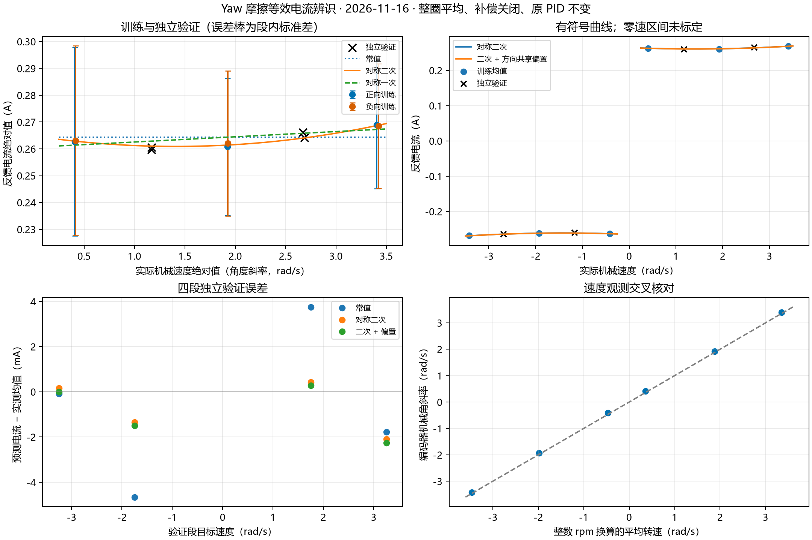

# Yaw 高配摩擦补偿：补采与离线拟合

2026-11-16，用户确认本轮“只补采和拟合，暂不改源码”

已完成 2,780 点实机采样及课件二次模型拟合，保留原始数据、运行前后参数和独立验证结果
拟合曲线尚未应用到控制器，零速过渡、启停和闭环改善均未验收

## 结果

以实际机械速度为自变量，反馈电流为因变量，对六个目标速度/方向工况等权最小二乘拟合：

```text
v = |ω|，ω 单位 rad/s
I_ff(ω) = sign(ω) × (0.264807088 - 0.005527878 × v + 0.001957453 × v²) A
```

系数单位依次为 A、A/(rad/s)、A/(rad/s)²
本轮标定工况的实际机械速度绝对值约为 0.408～3.421 rad/s，不能将目标 ±4 rad/s 写成实测已达到 ±4 rad/s
公式是本次稳态条件下的等效阻力电流候选，尚未把轴承摩擦、线束、磁阻和姿态相关负载逐一分离
本轮没有扭矩常数标定，不把安培系数当作 N·m 系数

| 模型 | 六工况训练 RMSE | 四段独立验证 RMSE | 独立验证最大绝对误差 |
| --- | ---: | ---: | ---: |
| 对称常值，幅值 0.264341 A | 0.003193 A | 0.003122 A | 0.004662 A |
| 对称一次 | 0.002122 A | 0.002134 A | 0.003211 A |
| 课件对称二次 | 0.000427 A | 0.001267 A | 0.002100 A |
| 对称二次加共享电流偏置 | 0.000395 A | 0.001366 A | 0.002263 A |

本轮独立验证中二次模型误差最小，增加共享偏置没有改善验证结果
这些误差针对每段整圈平均电流，不能当作瞬时电流精度：训练段内反馈电流标准差约 0.0226～0.0353 A
验证段每个方向/速度只有一次，尚不能给出可靠的跨日期、温度、负载置信区间

## 数据文件

- [原始采样](../../data/yaw_friction_multispeed_20261116_raw.csv)：每行含段名、UTC 时间、编码器/IMU 转速、目标、机械角、下发电流、反馈电流和 CAN 输出状态
- [会话与参数](../../data/yaw_friction_multispeed_20261116_session.json)：原始配置、最终配置、ELF 绑定、逐段写入及停止读回
- [逐段统计](yaw_friction_multispeed_20261116_summary.csv)
- [完整拟合结果](yaw_friction_multispeed_20261116_fit.json)：系数、预测值、残差、观测量敏感性及取窗比较
- [拟合图 PNG](yaw_friction_multispeed_20261116_fit.png) / [SVG](yaw_friction_multispeed_20261116_fit.svg)



## 现场条件与参数

- 实际采集时间：北京时间 18:54:36～19:08:43，分段采集有效时长合计 221.586 s，段间用于分析和 RELAX
- MCU/探针使用 EmberProbe 的当前工作区绑定：STM32F4，CMSIS-DAP，用户选择的序列号 332107146640
- ELF 为 `build/Debug/Infantry_Robot.elf`，SHA256 为 `b059709af541ebbcf9cbfc867495044e9c990bca0fe10abe3c42a86c6ef92a11`
- 每次采样和写入均报告固件一致性 `match`，未重新编译或烧录
- 使用独立调试命令，`gimbal_debug_enabled=true`，`gimbal_command.mode=1`，Pitch 暂时失能；每段结束回 RELAX
- Yaw 补偿保持关闭：`yaw_friction_current_a=0 A`，平滑尺度原值 0.2 rad/s
- Yaw 速度 PID 保持原 RAM 值：k=0.45、p=1、i=0、d=0.00008、i_limit=1、out_limit=1 A、d_cutoff_freq=-1、range=0
- Yaw 轴级 max_current_a 原值 10 A 保留；当前 PID 上限 1 A、补偿为零，本轮没有提高任何电流上限
- Yaw reversed=false，驱动 reverse=false，反馈标准帧 0x209，电流控制帧 0x2FE
- 一次现场快照中四轮 filtered_speed_rpm 均为 0；未连续采集底盘姿态，也未独立量测 Yaw 轴垂直度，因此水平条件是现场假设
- EmberProbe 写入返回现有工作区 `permission.mode=full`，写入结果逐项 verified=true，并报告 halted=true；不能将本次 RAM 写入描述为全程非停机

这里的反馈电流来自：

```text
motor_rm.c::can_managers[0]->motors[4]->feedback.torque_current
```

已读取该实例 `param.id=521=0x209`，并核对当前驱动按 `raw_current × 3 A / MOTOR_CUR_RES` 换算
它是当前固件解析的协议反馈电流，未通过外接电流仪表独立校准
`gimbal.yaw.output_current_a` 仅作为下发电流对照，不冒称反馈电流
运行中多字段读取并非原子快照，逐点下发/反馈差值还包含控制和采样不同步

## 工况与拟合方法

19 个采样段包括：1 段 RELAX 基线、4 段短低速诊断、10 段最终标定、4 段独立验证
短低速段保留在原始 CSV，因覆盖不足一圈，不进入最终回归

| 标定目标 rad/s | 实际机械速度 rad/s | 整圈平均反馈电流 A | 最终标定段数 |
| ---: | ---: | ---: | ---: |
| +1.0 | +0.408418 | +0.262677 | 1 个延长段 |
| -1.0 | -0.413155 | -0.263061 | 1 个延长段 |
| +2.5 | +1.921834 | +0.260782 | 2 |
| -2.5 | -1.927609 | -0.262047 | 2 |
| +4.0 | +3.403307 | +0.269007 | 2 |
| -4.0 | -3.421184 | -0.268471 | 2 |

独立验证段完全不参与求系数：

| 验证目标 rad/s | 实际机械速度 rad/s | 实测平均反馈电流 A | 二次模型预测 A | 预测减实测 A |
| ---: | ---: | ---: | ---: | ---: |
| +1.75 | +1.168311 | +0.260587 | +0.261021 | +0.000434 |
| -1.75 | -1.170258 | -0.259678 | -0.261019 | -0.001341 |
| +3.25 | +2.672502 | +0.266115 | +0.264014 | -0.002100 |
| -3.25 | -2.688003 | -0.264251 | -0.264091 | +0.000160 |

处理顺序：

1. 对输入 CSV 一次性检查有限数、段内命令恒定、运行状态和 CAN 输出状态；全部运行段采样点为 RUNNING，CAN 输出状态为 0
2. 每段先剔除起控后的 2 秒，在剩余数据中选择最后整数圈机械转动；插值整圈起点，使角跨度为整数倍 360°
3. 编码器机械角转弧度后对主机采样时间做一阶最小二乘，斜率作为该段实际机械速度；整数 rpm 与 IMU 速度用作交叉核对
4. 用梯形积分除以时间跨度得到反馈电流均值，降低采样间隔不均匀造成的权重偏差
5. 相同目标和方向的重复段先平均，再对六个工况等权回归；不会把同一段的密集时间点当作独立重复试验
6. 构造 `X=[sign(ω), ω, sign(ω)×|ω|²]`、`y=各工况反馈电流均值`，用 `numpy.linalg.lstsq(X,y,rcond=None)` 求系数
7. 在四段独立速度工况计算预测与残差，并比较常值、一次、二次及偏置模型

完整圈窗口通常为 1～4 圈；两个延长低速段各采 400 点，分别覆盖约 +758.98° 和 -771.50°
剔除起控过渡后，低速最终选取末尾一整圈，窗口均约 15.15 s；这两段目前各方向只有一个整圈观测
一阶机械角斜率与按整圈总角度/总时间得到的平均速度略有差异，原始数据保留以便复算

采样请求间隔为 25 ms，实际段内平均间隔 80.256 ms、中位数 78 ms、P95 为 93 ms
最大间隔 1216 ms 出现在 RELAX 基线，负向延长段早期出现过 1093 ms 的间断，该间断不在最终整圈取窗内
最终用于拟合和验证的窗口内最大采样间隔为 157 ms
梯形积分会对相邻样本间作线性近似，间隔内没有实测证据，均值误差不能当作完整连续波形的精度保证
控制周期为 2 ms，平均一个样本跨约 40 个控制周期
因此本次只能分析稳态统计与慢速变化，不能验收 500 Hz 单周期摩擦补偿行为

复算环境为 Python + NumPy 2.5.3 + Matplotlib 3.11.2；临时分析程序在结果验证后清理

## 短窗方向差异的复核

最初 +1 目标的最后五秒反馈均值约 +0.285～+0.294 A，-1 目标约 -0.246～-0.254 A
这些片段只覆盖部分机械转角，取窗变化会显著影响二次项，不能立即认定为正反方向固有摩擦不同
延长后按整圈平均得到 +0.262677/-0.263061 A，绝对值差缩小到约 0.000384 A
这支持“短窗口混入位置相关波动”的解释，但本轮未逐项分离线束、轴承和电磁因素，不能指定唯一原因

使用整数 rpm 均值替代机械角斜率时，二次系数为：

```text
a0 = 0.264707885 A
a1 = -0.005374216 A/(rad/s)
a2 = 0.001922634 A/(rad/s)^2
```

它与整圈机械角斜率版本接近，说明最终结论没有依赖未达到的目标速度
若重新退回最后 3/4/5 秒短窗，系数仍会改变，敏感性结果保存在 fit.json；不把这种局部取窗结果当成全角度标定

当前速度环无积分且前馈关闭，稳态有比例误差：+1 目标下，`0.45×(1-0.416)≈0.263 A`，与整圈反馈电流相符
旧记录在 +0.5 目标下不动时，静止比例电流约 `0.45×0.5=0.225 A`，小于本次约 0.263 A 的运行阻力电流
两者相容，但本轮没有复现旧故障全过程，不能单凭本次运动正常就宣称旧固件反馈问题已修复

## 与已有 ±0.5 数据的关系及应用边界

[旧拟合记录](yaw_friction_fit_20261116.md)的 ±0.5 是目标角速度 rad/s，不是角度 ±0.5 rad
该批拟合使用旧固件和控制器下发电流，本轮使用匹配的新固件及协议反馈电流，因此不直接混合回归

本轮完成了高配二次映射所需的多速度数据和离线验证，尚未标定零速附近、起动静摩擦、换向迟滞及高于约 3.4 rad/s 的实际速度
二次式的 a0 不能直接解释为静摩擦起动阈值
以后接入控制器时，必须按课件在零速附近连续化，并限制外推速度；过渡宽度和限幅数值仍需现场验证
上述曲线描述相对底盘的机械阻力，底盘运动时不能直接把大地系角速度当成相对轴承的速度使用

## 恢复及检查证据

- 最终与最初 `gimbal.config` 的 52 个标量配置值逐项相同，PID 与补偿参数未变
- 最后一次停止与恢复均 readBack verified=true，随后独立读回 debug=false、两个遥控环开关均 false、命令 RELAX、两轴状态 RELAX、输出均 0 A
- 原有持续采样会话保持开启，未改变观测列表、采样频率配置或探针绑定
- `User/module/config.c` 无 Git 差异，SHA256 为 `3228F43578255F33CF5B2A5A7830605EA88C07584F61C171A7E75F3F2AC7A677`
- 固件源码、结构体、CubeMX、RTOS/HAL 对象、ISR 及临界区均无改动；没有本轮新增或删除的固件判空、isfinite、范围检查及保护性 return
- 本次不构建新固件，不把采样结果当作补偿已上板；原固件的栈安全不在本次补采验收范围
- `python .auto-embedded/scripts/check.py` 初次 ARCH 因 PowerShell 签名策略失败；只在本次命令进程设 `PSExecutionPolicyPreference=Bypass` 后重新运行，ARCH/HW/SPEC 全部 PASS，未修改永久执行策略
- 图像已人工打开核对，数据导入检查、矩阵满秩检查及独立验证计算均执行成功
- 按 REVIEW 流程将实际速度/反馈电流辨识、整圈平均与均值误差边界沉淀到 conventions spec，不固化本次系数为项目默认参数
