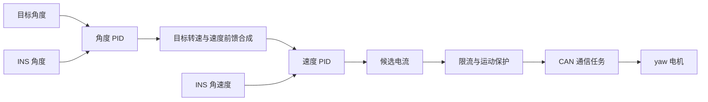
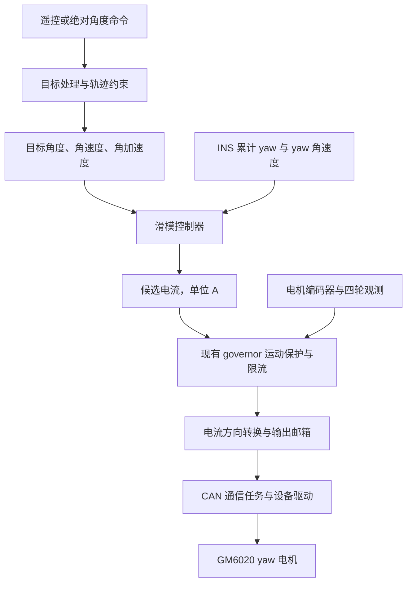

# 从 PID 到滑模：yaw 电机移植方案

- 日期：2026-10-29
- 适用分支：`feature/gimbal-smc`
- 源码基线：`560cdbf`
- 阅读对象：了解 PID，第一次接触滑模控制的开发者
- 文档状态：方案草案，尚未实施，控制参数和结构体设计尚未定稿

这次计划让滑模控制器根据 **yaw 角度和转动速度，直接计算电机电流**，接替正常角度控制中的两个 PID。
先完成 yaw，pitch 保留现有 PID。先验证方向、起停和保护，再调跟随效果。

文中的例子用来解释概念，不是可以直接上电使用的参数。本文没有修改固件，也不代表滑模已经通过实机验证。

## 1. 先看你熟悉的 PID 在工程里做什么

yaw 就是云台左右转动的轴。比如想让云台从当前的 8° 转到 10°，现在的程序分两步决定出力：

1. 角度 PID 看到还差 2°，给出一个目标转速
2. 速度 PID 比较目标转速与实际转速，给出电流

下面图里的 INS 是利用陀螺仪等传感器计算姿态和角速度的模块；CAN 是主控与电机驱动器通信的总线。
“前馈”表示利用已知的目标运动提前给出补偿，而不只等待误差出现后再纠正。



这叫串级 PID：外面一环管角度，里面一环管转速。两环的输出单位不同，角度环输出速度，速度环输出安培。

现有 PID 并不缺少速度反馈。换滑模的重点是改变“根据角度和速度决定电流”的计算方法。

## 2. 滑模也同时关心“差多远”和“转多快”

只知道角度误差，还不能决定该加速还是刹车。

还是当前 8°、目标 10°，下面三种情况需要的动作不同：

| 当前运动情况            | 控制器需要考虑的动作     |
| ----------------------- | ------------------------ |
| 停在 8°                 | 向 10° 的方向加速        |
| 正向 10° 移动，速度适中 | 继续接近目标，并逐渐减速 |
| 正向 10° 高速移动       | 提前制动，避免冲过目标   |

滑模先把角度误差和速度误差合成一个数，叫 **滑模变量 `s`**。
你可以先把它理解为“当前的位置和速度，是否配合得合适”。

### 2.1 用最简单的滑模面理解它

直接使用当前 PID 控制链已经在用的数据，不另起一套角度、速度变量名。
下表省略共同的 `gimbal.yaw.` 前缀，例如 `angle_deg` 就是调试器里的 `gimbal.yaw.angle_deg`。

| 工程现有变量                  | 含义                                          | 原有单位 |
| ----------------------------- | --------------------------------------------- | -------- |
| `angle_deg`                   | 实际 yaw 角度                                 | °        |
| `target_angle_deg`            | 本周期限幅后实际采用的目标角度                | °        |
| `speed_rad_s`                 | 实际 yaw 角速度                               | rad/s    |
| `setpoint.target_speed_rad_s` | 命令侧目标角速度，在 `ANGLE` 模式下是速度前馈 | rad/s    |
| `output_current_a`            | 保护处理后本周期输出的电流                    | A        |

角度误差直接用 `angle_deg - target_angle_deg` 计算。
速度误差用实际速度减目标速度；滑模内部使用度每秒时，两者一起乘 `180 / pi`。
换算只用于算法计算，不把原有 `speed_rad_s` 字段改存成度每秒。

这里需要分清两个已有字段：

- `setpoint.target_speed_rad_s`：命令给出的目标运动速度，滑模使用的是经过轨迹与保护处理后的这类参考速度
- `target_speed_rad_s`：当前 PID 路径中，角度纠偏与速度前馈合成、限幅后送给速度 PID 的目标

两者含义不同。替换两个 PID 后，不能再把旧 PID 合成的速度目标当成目标轨迹的速度，
否则会把原来的角度纠偏混进滑模参考里。已有观测字段怎样衔接，在实现前明确，当前文档不更改结构体。

误差计算沿用现有滑模算法的 `error` 与 `error_dot` 名称，`s` 仍表示滑模变量。
这些是控制计算中的中间量，不要求再新增一套云台反馈数据。

本文沿用现有滑模代码的误差方向：**实际值减目标值**。
如果你习惯 PID 的“目标减反馈”，这里正好反过来，后面的电流公式也必须配套使用。

最简单的线性滑模面是：

```text
error = angle_deg - target_angle_deg
error_dot = (speed_rad_s - 经过处理的命令侧目标速度) × 180 / pi
s = error_dot + C × error
```

`C` 是一个正参数，决定距离目标不同远近时，期望怎样的接近速度。
在线性例子里，它的单位是 `1/s`。

取一个只用于讲解的 `C = 5 /s`，目标静止在 10°，实际角度为 8°：

```text
error = 8 - 10 = -2°
s = speed_rad_s × 180 / pi - 10°/s
```

于是：

- 实际速度为 0°/s：`s = -10°/s`，说明还需要向目标方向增加速度
- 实际速度为 10°/s：`s = 0`，说明此时位置与速度符合选定的接近关系
- 实际速度为 30°/s：`s = 20°/s`，说明接近得过快，需要制动

**`s = 0` 不等于已经到达目标。** 它表示正在沿着选定的位置与速度关系运动。
在线性例子中，沿着 `s = 0` 接近时，距离越小，对应的接近速度也越小。

这只是理解控制目标的例子；真实电流还要结合目标加速度、输出增益和保护限制计算。

### 2.2 “滑”在哪里

控制器先把运动状态推向 `s = 0` 附近，再让它沿着这个关系接近目标，所以叫滑模控制。

描述“怎样把 `s` 推回零附近”的规则叫 **趋近律**。本项目原算法采用的思路是：

```text
s 的期望变化速度 = -K × s - epsilon × sat(s / phi)
```

- `K`：让偏离滑模面的状态往回收，数值越大，纠正动作越强
- `epsilon`：额外的趋近力度，可用于对抗一定范围内的扰动
- `phi`：零附近的过渡宽度，称为边界层厚度
- `sat`：把输入限制在 `[-1, 1]` 的函数

例如 `sat(3) = 1`、`sat(-2) = -1`，而 `sat(0.2) = 0.2`。
原代码使用固定边界的 `sat(s)`；这里写成 `sat(s / phi)` 是解释可调边界层的计划形式。
`epsilon` 表示趋近力度，原代码里的 `error_eps` 表示角度死区，两者不是同一个参数。

这里的 `K` 不是 PID 的 `Kp`，`epsilon` 也不是积分项，不能直接照搬 PID 参数。
这些参数的有效范围还受采样、噪声、电流限制和电机负载影响。

### 2.3 为什么滑模会抖

如果一过零就把控制动作从正切到负，传感器噪声会让电流在零附近反复换向，产生抖动和声音。
滑模里常把这种现象叫 **抖振**。

`sat(s / phi)` 在零附近提供连续过渡，减少硬切换。
边界层较宽时，动作更柔和，但精度和抗扰表现也会变化，需要一起测试。
不能仅靠增大增益追求“更硬”，也不能保证使用滑模就一定比现有 PID 更稳。

### 2.4 仓库里的“终端滑模”先理解到这里即可

仓库算法在误差较大时，用非线性的角度误差替代上面的 `error`；误差小于 1° 时改用线性形式。
非线性幂指数由 `q / p` 决定，原示例为 `21 / 27`。

它会改变不同误差下的接近规律。你现在只需记住：**滑模面仍然结合角度和速度，只是角度误差的权重关系变了。**

本次计划以现有算法为基础，修正周期、单位和边界行为。
近零区域要避免非线性除零，线性与非线性区域交界处要检查电流连续性。
数学上的收敛性质不能直接替代离散程序、限流条件下的实机验证。

## 3. 移植后的 yaw 控制链



这里替换的是正常 `ANGLE` 模式下的 yaw 控制计算。
GM6020 驱动器内部的电流控制能力继续使用，本次不修改它的内部算法。

| 模式或对象          | 计划采用的行为                                  |
| ------------------- | ----------------------------------------------- |
| yaw 的 `ANGLE` 模式 | 滑模直接计算电流，角度和速度 PID 不参与该路径   |
| yaw 的 `SPEED` 模式 | 保留速度 PID，作为独立速度调试入口              |
| `RELAX` 模式        | 零电流，清理相关控制历史                        |
| pitch               | 保留现有串级 PID                                |
| 滑模计算异常        | 停机并进入现有故障流程，不自动切回 PID 掩盖问题 |

## 4. 工程目前已经具备什么

以下内容已按 `560cdbf` 的源码核对。

| 现有内容                                     | 所在文件                            | 本次怎么使用                     |
| -------------------------------------------- | ----------------------------------- | -------------------------------- |
| C 版滑模实例 `SMC_t`、`SMC_Init`、`SMC_Tick` | `User/component/SMC/slidingmodec.*` | 作为算法适配的基础               |
| 两轴控制与状态机                             | `User/module/gimbal.*`              | 接入 yaw 滑模控制路径            |
| yaw 运动保护                                 | `User/module/gimbal_governor.*`     | 保留保护目的，适配滑模接口       |
| 两轴默认配置                                 | `User/module/config.c`              | 集中管理控制参数与限制           |
| 云台任务                                     | `User/task/motor_gimbal.c`          | 继续负责收反馈、调用模块、发输出 |
| 云台控制频率                                 | `User/task/user_task.h`             | 当前为 500 Hz，标称周期 2 ms     |
| 正弦测试入口                                 | `User/task/motor_gimbal.*`          | 后期比较跟随表现                 |

现有反馈已经区分了两种角度：

- **INS yaw**：云台相对惯性参考的朝向，闭环锁定它，yaw 使用累计角度
- **编码器机械角**：电机相对底座转了多少，供机械观测、连续角处理及保护使用

底座转动时，这两者不相同。滑模继续使用现有 INS 姿态反馈和已换算好的大地系 yaw 角速度，
不直接改用编码器角，也不把陀螺仪机体系 Z 轴读数直接当作所有姿态下的 yaw 角速度。

当前云台与 CAN 通信任务均为 500 Hz。滑模计算仍放在云台模块，由任务周期调用，不放进中断或 CAN 收包回调。

## 5. 接入前必须修正的六个问题

### 5.1 把“每周期变化量”换成速度和加速度

原代码用本周期目标角减上周期目标角，保存为 `target_dot`，但没有除以时间。
它得到的是“这一拍走了多少度”，不是“每秒走多少度”。

例如每 2 ms 目标前进 0.02°：

```text
每周期变化量 = 0.02°
目标速度 = 0.02° / 0.002 s = 10°/s
```

若把 `0.02` 当成 `10°/s` 使用，就把不同单位混在了一起。
计划直接使用现有实际控制周期 `period_s`，并明确本周期与历史值的更新时间顺序。

周期为零、负数、非有限值或超过允许范围时，按故障处理，不能继续做除法。
偶尔漏掉一个节拍时，也不能仍然把实际 4 ms 当成 2 ms。

### 5.2 优先使用命令已有的速度，避免重复前馈

当前命令已经包含目标角速度，正弦测试也能提供解析速度前馈。
滑模要用它构造速度误差，不再把同一份速度额外叠加一次。

计划按以下顺序处理：

1. 遥控增量继续由现有目标解析逻辑累加一次，滑模不重复积分
2. 轨迹处理产生相互一致的目标角度与目标速度
3. 有有效解析速度时优先使用；没有解析速度时，才对处理后的目标角度按时间差分
4. 目标加速度由一致的目标速度变化计算，并进行限幅或滤波
5. 起控、模式切换和保护接管时重新初始化历史，避免凭空出现加速度尖峰

外部突然把目标改远时，使用有速度和加速度约束的内部参考轨迹。
外部想去的位置与本周期真正可执行的参考位置要分清，保护期间不能在内部积累旧目标。

### 5.3 统一角度和电流单位

第一版建议滑模内部沿用“度”这一套单位，模块入口显式转换：

| 数据         | 工程现有单位   | 滑模内部计划单位   |
| ------------ | -------------- | ------------------ |
| yaw 姿态角   | °              | °                  |
| yaw 角速度   | rad/s          | °/s，乘 `180 / pi` |
| 目标角速度   | rad/s          | °/s，乘 `180 / pi` |
| 目标角加速度 | 由参考轨迹生成 | °/s²               |
| 输出电流     | A              | A                  |

原示例的 `u_max = 25000` 是原工程输出尺度，不能直接赋给本工程的电流接口。
本工程驱动按 GM6020 电流协议进行换算，源码定义为 `±3 A` 对应 `±16384`。
这个映射说明本工程驱动如何工作，**不能证明原示例的 25000 就是同一类电流原始值**。

计划让算法最终输出安培，协议换算继续由已有设备层完成。
原 `J` 需要重新核对单位和标定；没有电机转矩常数与负载模型时，不把示例里的数值当成本机物理惯量。

### 5.4 接近目标时仍然需要刹车

原算法只要角度误差进入 `error_eps`，就立即返回零输出。
但“刚好经过目标位置”不代表“已经停稳”。例如角度误差接近零，实际速度仍然很大，此时仍需要制动。

计划保留近零速度反馈作用。若设置停止死区，必须同时考虑角度、速度和跟随需求，
不能仅凭角度误差撤掉电流。外部扰动存在时也可能需要小电流保持位置。

无论是否进入死区，都要维护本周期历史，避免退出死区后使用过期数据。

### 5.5 避免近零计算异常和分段电流跳变

原算法包含非线性幂和除以角度误差的计算，小误差时又改用线性控制律。
计划先判断适用区域，再计算对应公式，避免先做危险除法、之后再覆盖结果。

`p`、指数范围、限幅、增益和输入都需要校验。
在零点、死区边缘和 1° 分段边界两侧测试输出，必要时加入平滑过渡。
边界层宽度若变为可调参数，要先确认接口与字段设计；现有代码的饱和边界是固定的。

### 5.6 不再依赖速度 PID 实现速度约束

原来滑模替换掉两个 PID 后，也就没有“先生成一个限幅速度，再交给速度 PID”的控制链了。
原 `max_speed_rad_s` 不能只留在闲置的 PID 分支里。

计划将速度与加速度限制落实到参考轨迹，并核对实测超速时的保护动作。
参考速度受限不等于实际电机绝不会超速，底座扰动和负载变化仍可能改变实际速度。
具体阈值和动作在实施前确认，不把手册空载转速直接当成新的实机保护阈值。

## 6. 先理解输出电流如何计算，再谈参数

为了便于理解，线性滑模可写成下面的教学形式：

这里假设正电流产生正方向角加速度，并用简化的二阶运动模型描述 yaw。
实际摩擦、阻尼、底座运动与模型误差仍需通过测试评估，不能把这个公式当成完整的电机模型。

```text
error = angle_deg - target_angle_deg
error_dot = (speed_rad_s - 经过处理的命令侧目标速度) × 180 / pi
s = error_dot + C × error

候选电流 = J × [目标角加速度 - C × error_dot - K × s - epsilon × sat(s / phi)]
最终电流 = 对候选电流执行运动保护和限流
```

这里沿用现有 `SMC_t.J` 的名称，在完成单位适配后表示“需要多少电流才能产生所需角加速度”的等效换算增益。
它的尺度需要重新标定，不能直接照搬原示例数值。
终端滑模会把其中的 `error` 与相应导数项换成非线性形式，最终使用的分段公式需要单独复核。
最终电流继续写入现有 `output_current_a`，后续发布和通信链路沿用原有接口。

| 参数或限制           | 可以先怎样理解             | 调整时观察什么               |
| -------------------- | -------------------------- | ---------------------------- |
| `C`                  | 希望多快缩小位置误差       | 接近速度、超调、到位时间     |
| `K`                  | 偏离滑模面后拉回的力度     | 振荡、速度噪声放大、电流变化 |
| `epsilon`            | 额外的趋近力度             | 扰动恢复、静止抖动、噪声     |
| `phi`                | 零附近多大范围采用柔和过渡 | 细小误差、电流抖动、声音     |
| `q / p`              | 非线性接近规律的形状       | 大小误差区间差异、分段过渡   |
| 等效输出增益         | 计算结果换成安培的尺度     | 出力是否不足、是否频繁限流   |
| 电流上限             | 本周期最多允许多大电流     | 峰值电流、持续饱和、温升     |
| 参考速度和加速度上限 | 目标轨迹允许多激进         | 目标突变、电流尖峰、跟随滞后 |

参数表仅说明职责，不给出本机已验证的滑模增益。
当前默认电流上限是 `0.5 A`，首次测试可在此之下设置更低的调试限额，结合实际负载确认。
电流太低可能无法克服摩擦，太高又会放大方向或参数错误；“低限流”仍需结合实测判断。

## 7. 起控、故障和运动保护怎样衔接

### 7.1 继续使用现有轴状态机

| 状态      | 电流与控制历史                 | 怎样离开                                 |
| --------- | ------------------------------ | ---------------------------------------- |
| `RELAX`   | 零电流，清理滑模历史           | 运行请求与反馈有效后捕获当前姿态起控     |
| `RUNNING` | 周期执行滑模和输出保护         | 停机、反馈失联或计算异常时转移           |
| `OFFLINE` | 该轴零输出，不继续累加控制历史 | 有效反馈恢复且运行请求有效时重新捕获目标 |
| `FAULT`   | 故障零输出并锁存               | 按现有流程回 `RELAX`，重新满足条件后恢复 |

起控时把内部目标对齐到当前姿态，并重置目标差分与输出历史。
姿态捕获用于避免追赶旧目标；它不代表真实速度必须被伪装成零。

现有电机反馈时效上限为 90 ms，IMU 源数据时效上限为 10 ms。
滑模不能绕过这些检查，也不能因为控制计算在运行就刷新旧反馈的时间戳。
IMU 锁存故障、遥控失联和输出发布失败继续遵循现有整机停机与重新使能流程。

### 7.2 governor 是输出保护，不是另一个位置控制器

现有 yaw governor 使用编码器速度、INS 速度和独立四轮观测，识别异常运动，
并按情况限流、撤驱、制动、捕获新目标和逐渐恢复。

目前它还会修改 PID 积分：实际执行电流比 PID 请求小，就回调积分，避免 PID 越积越多。
滑模路径不使用这两个 PID 积分，因此需要把这部分处理与通用保护分开。

计划保留对实际执行电流的记录，同时做到：

- PID 调试路径继续使用相应积分处理
- 滑模路径不写无关的 PID 积分
- 保护接管时捕获参考并重置差分，恢复时逐步放开滑模输出权限
- 不能只减小目标速度前馈，却让角度纠偏电流全量输出
- 现有四轮观测不可用时，继续按当前保护规则撤销 yaw 输出

测试时必须同时记录“保护前电流”和“实际输出电流”。
如果滑模算出了电流，但 governor 把它限制为零，单看电机不动就增大滑模增益会误判原因。

## 8. 代码按层改，先不定稿结构体

| 文件范围                            | 计划修改内容                             | 需要确认或验证的重点                   |
| ----------------------------------- | ---------------------------------------- | -------------------------------------- |
| `User/component/SMC/slidingmodec.c` | 周期、前馈、近零计算、输出尺度与数值检查 | 控制律符号、边界连续性、非法输入       |
| `User/component/SMC/slidingmodec.h` | 根据适配结果调整接口说明                 | 参数单位、返回状态、兼容性             |
| `User/module/gimbal.c`              | yaw `ANGLE` 路径接入滑模，衔接状态机     | 起停、方向转换、模式切换、保护调用顺序 |
| `User/module/gimbal.h`              | 讨论实例归属、配置与观测接口             | 结构体名称和字段须经用户确认           |
| `User/module/gimbal_governor.*`     | 解耦 PID 积分处理，适配控制权限恢复      | 保护不能被滑模绕过                     |
| `User/module/config.*`              | 集中定义默认参数与限制                   | 参数注释、单位、参数采纳与复位策略     |
| `User/task/motor_gimbal.*`          | 按实际需要补充调试入口                   | 任务继续只负责编排                     |

建议复用已有 `SMC_t` 表达算法运行状态，使其归属于 yaw 控制实例。
控制参数与历史数据要职责清楚，不能把运行时指针或整个实例直接保存成跨版本 Flash 配置。
是否增加配置类型、怎样命名字段，实施前先听取用户想法，再比较可读性、职责边界、扩展性和兼容性。

本次规划不需要改引脚、CAN 协议、IMU 安装关系或 CubeMX 外设配置。
若实际实现新增源文件，则同步登记 CMake 和 Keil；仅改已有文件时先核对现有登记即可。

## 9. 分四步实施，每一步都留证据

### 第一步：记录 PID 对照数据

先保存当前固件提交、参数、参考轨迹、负载和电流限额。
在同一套条件下记录定点保持、小角度跟随和扰动恢复，作为以后判断滑模效果的依据。

当前尚无本次试验条件下的 PID 实机对照数据，需要在上板阶段补齐。

### 第二步：修正并验证滑模算法

先用主机测试验证实际算法，覆盖：

- 正负角度误差、不同方向转速与制动
- 零误差但存在速度误差
- 死区边缘、1° 分段边界、正负电流限幅
- 连续目标、阶跃目标、正弦目标及其前馈
- 不同有效周期、零周期、过长周期、`NaN/Inf` 和非法参数
- 起控重置后不会因旧历史产生假加速度

这些测试证明数值行为符合设计，不证明真实电机已经稳定。

### 第三步：接入模块并验证状态与保护

验证 yaw 的正常角度路径确实使用滑模，pitch 及 `SPEED` 调试路径符合方案。
再覆盖停机、反馈中断、故障锁存、恢复、四轮观测无效和 governor 各保护阶段。

完成固件编译与静态检查，核对没有增加下层反向依赖、没有在临界区或中断里运行控制算法。
参数修改的第一版建议只在 `RELAX` 时采纳，再统一校验和复位；若要运行中在线生效，需另外明确一致性策略。

### 第四步：低限流上板，逐项增加测试强度

| 次序 | 测试动作             | 通过时要看到的证据                       |
| ---- | -------------------- | ---------------------------------------- |
| 1    | 上电保持 `RELAX`     | 电流为零，模式与故障观测正确             |
| 2    | 捕获当前位置后使能   | 无旧目标追赶，首周期没有异常电流尖峰     |
| 3    | 给小幅正向、反向目标 | 电流与误差方向匹配，能接近目标并制动     |
| 4    | 静止保持与受控小扰动 | 记录误差、电流与恢复曲线，无持续大幅振荡 |
| 5    | 小幅低速正弦跟随     | 记录误差、相位滞后、限流占比和噪声       |
| 6    | 受控底座旋转         | 反馈坐标和 governor 行为与设计一致       |
| 7    | 模拟失联、恢复和停机 | 输出、状态与重新捕获目标符合约定         |

第 3 步若发现误差越控越大，先停机核对符号、INS 方向和输出方向，不继续靠调大参数尝试纠正。
现有正弦测试配置为振幅 30°、相位速度 6 rad/s，首次滑模试验先使用更温和且经过确认的轨迹。
yaw 当前没有启用机械行程限位，首次小角度测试仍需确认线束允许行程。

## 10. 调参时先看什么

先确认反馈有效、方向正确、保护没有意外接管，再调整算法。
保持相同轨迹和负载，一次只改一类参数，并保存修改前后的录波。

建议顺序为：

1. 核实电流尺度、限流和等效输出增益
2. 在小角度、低动态目标下调整 `C` 与 `K`，观察接近和制动
3. 逐步评估 `epsilon` 与边界层，平衡扰动恢复和静止抖动
4. 再评估非线性指数与分段过渡，最后增加轨迹速度和幅度

不能同时修改全部参数后，仅凭“看起来更快”判断是哪项起效。
如果大部分时间都卡在电流上限，先检查目标是否过激、换算是否正确以及输出增益是否合适。
持续限流时，继续增大增益未必能提高实际出力。

## 11. 调试器或录波至少记录这些量

| 观测量                           | 用来解释什么                       |
| -------------------------------- | ---------------------------------- |
| 外部目标、内部参考角度与实际角度 | 是命令跳变、参考受限，还是跟随不足 |
| 目标速度、实际 INS yaw 速度      | 是否需要制动、前馈是否一致         |
| `error`、`error_dot`、`s`        | 滑模根据什么决定动作               |
| 保护前电流、保护后电流           | 算法出力与保护限制各占多少         |
| 电机反馈电流                     | 请求电流与设备反馈是否一致         |
| 轴状态、IMU 状态、governor 状态  | 是否处于运行、失联或保护过程       |
| 实际控制周期、反馈帧龄、计算耗时 | 调度与传感器是否影响控制           |

高频控制循环不逐周期阻塞打印，优先使用现有调试观测或受控录波方式。
移植前后比较角度误差、超调、到位时间、电流峰值、持续限流比例、抖动和耗时。
“能转动”只证明输出链有动作；是否达到预期，需要这些数据支持。

## 12. 本文交付时的检查与验证边界

| 检查                               | 结果与范围                                                           |
| ---------------------------------- | -------------------------------------------------------------------- |
| 分支与源码基线                     | `feature/gimbal-smc`，`560cdbf`，编写前工作树干净                    |
| 频率、反馈、配置与现有算法核对     | 已只读核对，本文明确区分现状与计划                                   |
| 机械门禁                           | `python .auto-embedded/scripts/check.py`，ARCH / HW / SPEC 全部通过  |
| 现有固件构建                       | 前序方案核对中执行 `cmake --build --preset Debug --parallel 2`，通过 |
| 滑模接入软件测试                   | 尚未实施，本文列出后续覆盖项                                         |
| 电机运行、控制耗时、温升与效果对比 | 尚未实测                                                             |

本文是可讨论、可逐步落实的移植计划，不把计划中的算法接口或保护适配记为已完成。
后续实施仍需确认 `User/module`、`User/component/SMC` 等源码范围，以及结构体名称和字段设计。
确认后每完成一个独立实现点，按项目规则复核、验证、记录，再创建本地提交。

## 13. 对照阅读这些工程文件

- [现有滑模算法](../../User/component/SMC/slidingmodec.c)
- [滑模实例与接口](../../User/component/SMC/slidingmodec.h)
- [原算法使用说明与来源](../../User/component/SMC/readme.md)
- [云台模块](../../User/module/gimbal.c)
- [云台数据结构与模式说明](../../User/module/gimbal.h)
- [yaw 运动保护](../../User/module/gimbal_governor.c)
- [两轴默认参数](../../User/module/config.c)
- [云台任务与正弦测试](../../User/task/motor_gimbal.c)
- [任务频率定义](../../User/task/user_task.h)
- [GM6020 电流协议实现](../../User/device/motor_rm.c)
- [此前 C 语言迁移与验证记录](2026-10-25_smc_c_migration.md)
